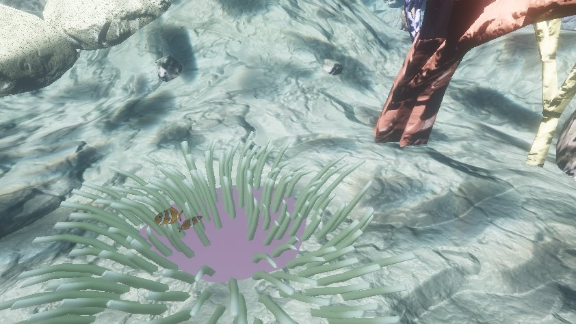
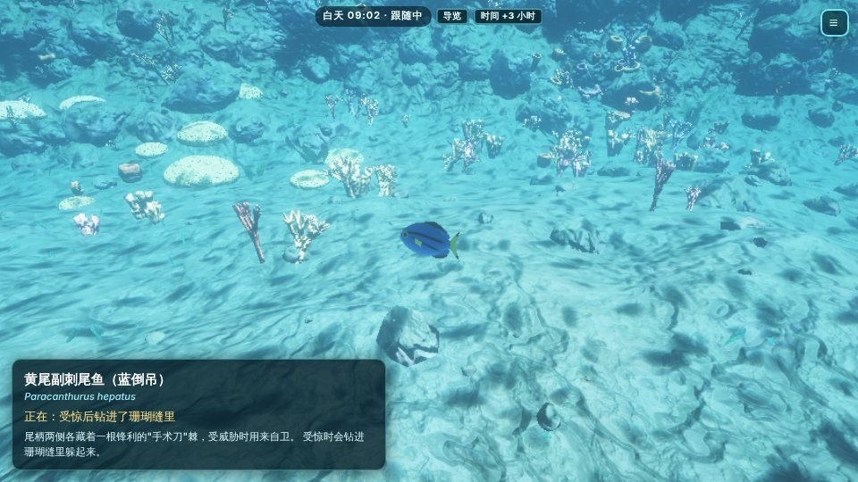
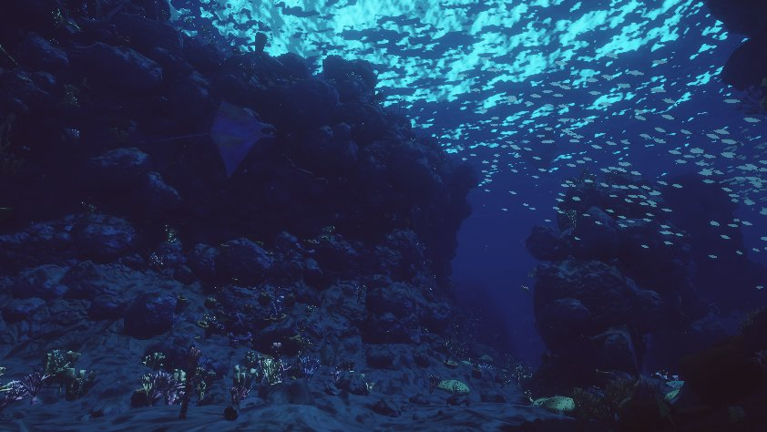
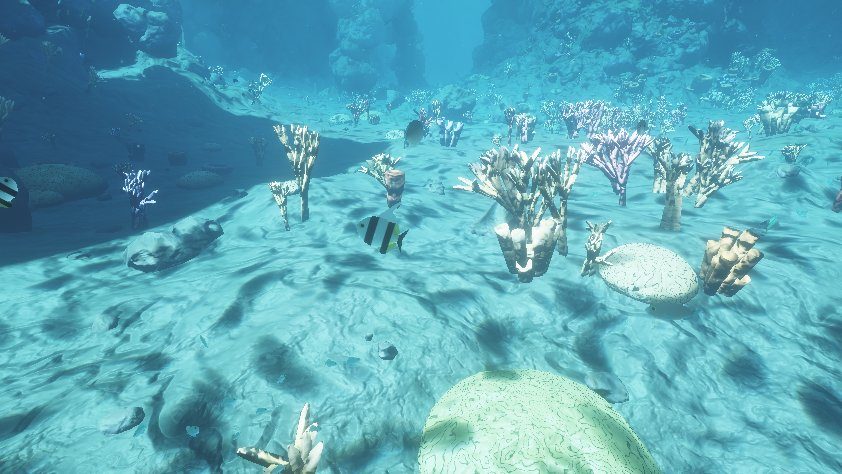
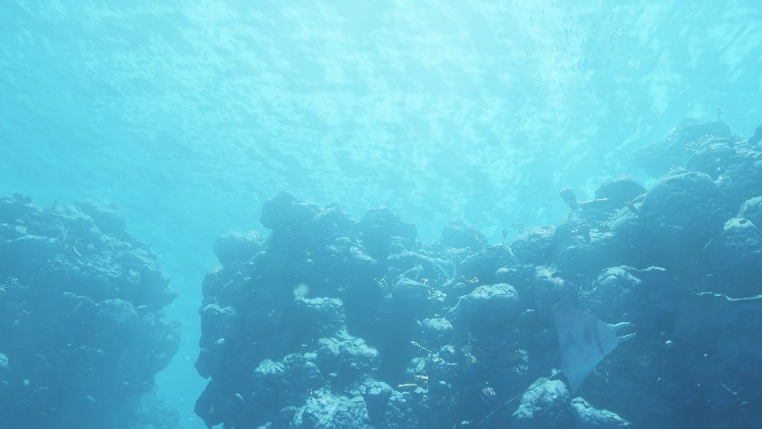

# 珊瑚之窗 Coral Window

**在浏览器里潜进一片印度-太平洋珊瑚礁，看鱼儿们过自己的日子。**

不是游戏，没有分数。一进去就在"海葵花园"：几丛海葵和住在里面的小丑鱼，靠近的鱼会被圈出来、标上名字。你可以自由游动，也可以跟着一条鱼看它在做什么：小丑鱼守着自己的海葵，光鳃鱼在珊瑚上方啄食浮游生物，
鹦嘴鱼啃礁石上的藻类，清洁鱼在"清洁站"给别的鱼清理寄生虫，东星斑躲在珊瑚旁伺机伏击，天黑以后海鳝出洞、鹦嘴鱼吐出黏液"睡袋"。



| | |
|---|---|
|  |  |
|  |  |

## 怎么打开

1. 下载 [`index.html`](index.html)（或者打开 GitHub Pages 上的网页版）。
2. 用电脑上的 **Chrome** 或 **Edge** 打开（需要 WebGPU）。
3. 等几秒钟生成珊瑚礁，点 **潜入水中**。

## 操作

| | 键盘和鼠标 | 手机 |
|---|---|---|
| 看四周 | 移动鼠标 | 滑动 |
| 游动 | `W` `A` `S` `D`，`Q` / `E` 下 / 上，按住 `Shift` 加速 | 按住屏幕向前游，两根手指加速 |
| 看一条鱼的介绍 | 把它放在屏幕正中，卡片自动出现 | 点一下那条鱼 |
| 跟随它 | `G` | 点一下卡片 |
| 自动导览（像看纪录片） | `T` | 顶部的 **导览** 按钮 |
| 快进时间 | 按住 `N` | 顶部的 **时间 +3 小时** |
| 潜水手电筒 | `L` 开 / 关 | |
| 小地图（带 A–H / 1–8 格子坐标） | `M` 开 / 关 | 顶部的 **地图** |
| 菜单 / 静音 / 观景点 | `Esc` / `V` / `1`–`6` | |

## 礁区里有什么

一天在大约 12 分钟里过完（夜里过得更快）。每种生物的行为跟着时间变化：

| 生物 | 白天 | 黄昏 / 夜晚 |
|---|---|---|
| 眼斑双锯鱼（小丑鱼） | 在海葵上方游动，你靠太近会冲过来"赶人"，有危险就钻进触手里 | 在海葵里过夜，海葵的触手收拢一些 |
| 蓝绿光鳃鱼 | 成群停在枝状珊瑚上方，头朝着水流啄食浮游生物 | 一有捕食者靠近就钻进珊瑚；夜里躲在珊瑚里 |
| 裂唇鱼（清洁鱼） | 守在清洁站，别的鱼来"摆姿势"时给它清理 | 躲起来睡觉 |
| 鹦嘴鱼 | 三五成群，用"鸟嘴"啃礁石上的藻类，偶尔去清洁站 | 裹在黏液"睡袋"里睡觉 |
| 镰鱼 | 成对巡游，啄食海绵和藻类 | 在礁石旁休息 |
| 豹纹鳃棘鲈（东星斑） | 停在珊瑚旁伏击，偶尔出击 | 黄昏、清晨捕猎最积极，会悄悄接近光鳃鱼然后冲刺 |
| 黄尾副刺尾鱼（蓝倒吊） | 成群在礁区上方觅食，受惊就钻进珊瑚缝 | 躲在珊瑚缝里过夜 |
| 黑鳍礁鲨 | 在礁区巡游，会避开你 | 游得更快，开始觅食 |
| 爪哇裸胸鳝（巨海鳝） | 从洞里探出头呼吸 | 出洞觅食，天亮前回洞 |
| 阿氏前口蝠鲼 | 在礁区上方滑翔 | |

物种的知识和行为都有出处，见 [SPECIES.md](SPECIES.md)。这是一个"好看、放松"的观景作品，行为是简化过的，不是科学模拟。

## 自己改

源代码在 [`source`](source) 文件夹。需要 [Node.js](https://nodejs.org) 18 以上：

```bash
cd source
npm install
npm run build        # 生成 index.html
npm run build:dev    # 生成 dev.html（带开发工具）
```

| 文件 | 内容 |
|---|---|
| [`source/src/eco.js`](source/src/eco.js) | 礁区的生物：物种资料、每种鱼的行为、昼夜、介绍卡片、跟随和导览 |
| [`source/src/reef.js`](source/src/reef.js) | 脑珊瑚、桌形珊瑚、海葵、鱼、鲨鱼、海鳝的模型 |
| [`source/src/world.js`](source/src/world.js) | 地形和珊瑚礁的布置 |
| [`source/src/shaders.js`](source/src/shaders.js) | 画面：水的颜色、光照、珊瑚和每种鱼的花纹（`W_REEF`） |
| [`source/src/main.js`](source/src/main.js) | 渲染器、镜头、操作 |

## 致谢和许可

本项目基于 Maksymilian Dendura（Noniv）的 [Abyssal Garden](https://github.com/Noniv/abyssal-garden)，以 [MIT 许可](LICENSE) 发布。
地形、水、光线、渲染器都来自原作；珊瑚礁、生物和它们的行为是本项目加的。原作的版权声明保留在 [LICENSE](LICENSE) 里。
